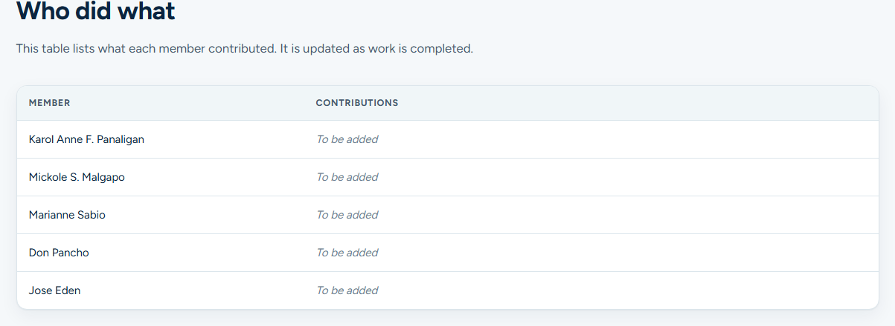

# Healthcare Prioritization Simulator

This is the final project for IS 201 Computer Ethics. It is a four-page website where visitors change decisions about prioritizing patients in a public hospital. A rule-based model then shows the consequences for equity, governance, and sustainability.

## Pages

| Page                | File                | Purpose                                                                          |
| ------------------- | ------------------- | -------------------------------------------------------------------------------- |
| Home                | `index.html`        | Scenario overview, project video, and the team                                   |
| Simulator           | `simulator.html`    | Decisions go in, and the consequence dashboard and explanations come out         |
| How the Model Works | `how-it-works.html` | Diagram, rules, interactions, assumptions, and limitations                       |
| References          | `references.html`   | Sources, declaration of AI use, and who did what                                 |
| Notes               | `notes.html`        | A draft proposal for the team. It is not in the navbar and is served at `/notes` |

## Technology choices

| Topic         | Choice                              | Reason                                                                             |
| ------------- | ----------------------------------- | ---------------------------------------------------------------------------------- |
| Languages     | HTML, CSS, and plain JavaScript     | The course requires them                                                           |
| Build step    | None                                | The course does not allow frameworks that need one, such as React, Vue, or Next.js |
| Database      | None                                | The site is static and runs on GitHub Pages                                        |
| Table content | Excel files in `assets/tables/`     | Teammates can edit tables without touching the HTML                                |
| Excel reader  | SheetJS, stored in `assets/vendor/` | Lets the pages read the Excel files in the browser                                 |
| Hosting       | GitHub Pages                        | The course requires a public repository and a Pages link                           |

## Run locally

1. Clone the repository and open the folder.

   ```bash
   git clone git@github.com:healthcareprio/healthcareprio.github.io.git project-upou-is201-healthcare-prio-sims
   cd project-upou-is201-healthcare-prio-sims
   ```

2. Start a local web server. Use either option below.

   **Option 1: Python (recommended)**

   ```bash
   python -m http.server 8000
   ```

   **Option 2: VS Code**

   Install the Live Server extension, right-click `index.html`, and choose **Open with Live Server**.

3. Open the site in a web browser.

   ```text
   http://localhost:8000
   ```

4. Stop the Python server with `Ctrl+C` when you are done.

> **Note:** The tables are loaded from the files in `assets/tables/`. Browsers block this when `index.html` is opened directly from disk, so the pages show an error message in place of the tables. Always use a local server.

## Deploy to GitHub Pages

The site is deployed from the `healthcareprio` GitHub organization. To create the organization and move the repository into it, see [Set up the GitHub organization](#set-up-the-github-organization).

The course requires a **public** repository.

1. Push your changes to GitHub. The default branch is `master`.

   ```bash
   git add .
   git commit -m "Update site"
   git push origin master
   ```

2. Make sure the repository is public: **Settings ➜ General ➜ Danger Zone ➜ Change visibility**.
3. Open **Settings ➜ Pages**.
4. Under **Build and deployment**, set **Source** to **Deploy from a branch**.
5. Select the branch `master` and the folder `/ (root)`, then click **Save**.
6. Wait about a minute. The site is published at this address:

   ```text
   https://healthcareprio.github.io/
   ```

7. Open the link in a private browser window and click through all four pages before submitting. The link must load as submitted.

Every later push to `master` redeploys the site automatically.

## Set up the GitHub organization

A site address like `healthcareprio.github.io` is a GitHub organization site. It requires an organization named `healthcareprio` that owns a repository named exactly `healthcareprio.github.io`.

### 1. Create the GitHub organization

1. Go to the page below.

   ```text
   https://github.com/account/organizations/new
   ```

2. Select the appropriate GitHub plan.
3. Enter the organization account name: `healthcareprio`.
4. Provide your contact email.
5. Select **My personal account** when asked who the organization belongs to.
6. Add the organization members.
7. Complete the organization creation.

If the name is available, the organization is created at this address:

```text
https://github.com/healthcareprio
```

### 2. Transfer the existing repository

1. Open the existing repository.

   ```text
   https://github.com/joseeden/project-upou-mis-is201-healthcare-prio-sims
   ```

2. Go to **Settings ➜ General ➜ Danger Zone ➜ Transfer ownership**.
3. Choose the `healthcareprio` organization as the new owner.

### 3. Rename the repository

1. In the transferred repository, go to **Settings ➜ General**.
2. Change the repository name to `healthcareprio.github.io` and click **Rename**.

### 4. Update the local Git remote

Check the current remote.

```bash
git remote -v
```

```text
origin  git@github.com:joseeden/project-upou-mis-is201-healthcare-prio-sims.git (fetch)
origin  git@github.com:joseeden/project-upou-mis-is201-healthcare-prio-sims.git (push)
```

Point it at the new location.

```bash
git remote set-url origin git@github.com:healthcareprio/healthcareprio.github.io.git
```

Confirm the change.

```bash
git remote -v
```

```text
origin  git@github.com:healthcareprio/healthcareprio.github.io.git (fetch)
origin  git@github.com:healthcareprio/healthcareprio.github.io.git (push)
```

Transferring and renaming the repository does not affect:

- Commit history
- Existing branches
- Collaborators and permissions
- Issues and pull requests
- The local project folder name

You can rename the local folder to anything you like. Git does not care about the folder name.

## Editing the model

| File                               | What it controls                                                                                       |
| ---------------------------------- | ------------------------------------------------------------------------------------------------------ |
| `assets/tables/` (Excel)           | Decisions, options, indicators, effects, and interactions used by the simulator (see below)            |
| `js/site.js`                       | Site name and the list of team members                                                                 |
| `index.html`                       | The Home text and the YouTube embed (replace the marked placeholder block)                             |
| `assets/images/hero.jpg`           | The photo shown in the Home hero (optional)                                                            |
| `assets/images/social-preview.jpg` | The thumbnail shown when the link is shared on WhatsApp, Discord, and similar apps (1200 × 630 pixels) |

Notes on how the scores work:

- Each indicator starts at 50.
- Each selected option adds its effect to the indicators.
- Matching interactions add extra effects.
- The final score is capped between 0 and 100.
- The simulator reads the model directly from four Excel files, so there is nothing to copy into the code. Edit the Excel files and upload them.
- The same files are shown on the How the Model Works page, so the page and the simulator always agree.
- Until the files are filled in, the simulator shows a demo model and says so. Problems in the files, such as a rule that names a decision that does not exist, are listed on the Simulator page.

| File                                 | What to write                                                                                                                 |
| ------------------------------------ | ----------------------------------------------------------------------------------------------------------------------------- |
| `02-decision-variables-options.xlsx` | One row per decision variable. Put each option in its own cell. A second line in the cell is the description.                 |
| `03-indicators.xlsx`                 | One row per consequence, with its dimension and what it measures.                                                             |
| `04-rules.xlsx`                      | One row per option. Write the rule as `Decision variable: Option` and each effect on its own line, like `Accountability -15`. |
| `05-interactions.xlsx`               | Write each choice on its own line under "Applies when", and the effect in the same format as the rules.                       |

Use the exact decision, option, and indicator names everywhere, and avoid commas inside a name.

## Edit and upload table files

Every table on the site is an Excel file in `assets/tables/`. You edit the file in Excel, upload it to the GitHub repository, and the page updates. No HTML changes are needed.

| File                                        | Page                | Content                                       |
| ------------------------------------------- | ------------------- | --------------------------------------------- |
| `02-decision-variables-options.xlsx`        | Simulator           | The decision variables and their options      |
| `03-indicators.xlsx`                        | How the Model Works | What each consequence measures                |
| `04-rules.xlsx`                             | How the Model Works | Effect, evidence, and weight for every option |
| `05-interactions.xlsx`                      | How the Model Works | The pairs of decisions that change a result   |
| `20-references-online-references.xlsx`      | References          | Online sources                                |
| `21-references-declarations-of-ai-use.xlsx` | References          | Declaration of AI use                         |
| `22-references-contributions.xlsx`          | References          | Who did what                                  |
| `23-references-design-inspiration.xlsx`     | References          | Design references                             |

### Before you start

- You need Microsoft Excel, or a free alternative such as LibreOffice Calc.
- You need a GitHub account that belongs to the `healthcareprio` organization with write access. 
- Tell the group before you edit a file. If two people upload the same file, the later upload replaces the earlier one.

### Step 1: Download the latest file

1. Open the tables folder on GitHub.

   ```text
   https://github.com/healthcareprio/healthcareprio.github.io/tree/master/assets/tables
   ```

2. Click the file you want to edit, for example `04-rules.xlsx`.
3. Click the **Download raw file** button (the download icon at the top right of the file view) and save the file to your computer.

Always download a fresh copy before you start, so you edit the newest version.

### Step 2: Edit the file in Excel

Follow these rules so the website can read your changes:

- Keep the header in row 1 and keep the table on the first sheet. Other sheets are ignored.
- Do not merge cells.
- Press `Alt+Enter` to start a new line inside a cell. On a Mac, press `Control+Option+Return`.
- To add a link, select the cell and press `Ctrl+K`. You can also type `[link text](https://example.com)` inside a cell.
- Any cell that contains "To be added" is shown in grey italics on the site.
- Save the file as an Excel Workbook (`.xlsx`) with the same file name. Do not save it as CSV or `.xls`.
- Close Excel before you upload the file.

### Step 3: Upload the file to GitHub

1. Open the tables folder on GitHub again.
2. Click **Add file ➜ Upload files**.
3. Drag your edited file into the page. The file name must match the original exactly, so that it replaces the old file.
4. Under **Commit changes**, write a short message, for example `Update rules table`.
5. Select **Commit directly to the master branch**, then click **Commit changes**.

### Step 4: Check the result

1. Wait one to two minutes for GitHub Pages to publish the change.
2. Open the page on the live site and press `Ctrl+F5` to reload it without the old cached copy.

   ```text
   https://healthcareprio.github.io/
   ```

3. Find your table. This is how the "Who did what" table looks on the References page:

   

### Troubleshooting

| Problem                             | Likely cause                                 | Fix                                                                        |
| ----------------------------------- | -------------------------------------------- | -------------------------------------------------------------------------- |
| The page shows a table error        | The file name changed or the format is wrong | Rename the file back, and save it as `.xlsx`                               |
| Your change does not appear         | GitHub Pages is still publishing             | Wait two minutes and press `Ctrl+F5`                                       |
| There is no **Upload files** option | Your account does not have write access      | Request access to the organization                                         |
| Some characters look wrong          | The file was saved as CSV                    | Save it again as an Excel Workbook (`.xlsx`)                               |
| You overwrote someone's changes     | Two people edited the same file              | Ask for their copy, or re-download the older version from the file history |

The flow diagram on the How the Model Works page is `assets/diagrams/decisions-to-consequences.drawio`. Open it at [app.diagrams.net](https://app.diagrams.net), edit it, then export it as SVG to `assets/diagrams/decisions-to-consequences.svg`.

## Project structure

| Path                                                                   | Purpose                                                |
| ---------------------------------------------------------------------- | ------------------------------------------------------ |
| `index.html`, `simulator.html`, `how-it-works.html`, `references.html` | The four pages                                         |
| `css/styles.css`                                                       | Design tokens and styles                               |
| `js/site.js`                                                           | Navbar, footer, and team data                          |
| `js/model-config.js`                                                   | A demo model used until the Excel tables are filled in |
| `js/model-loader.js`                                                   | Builds the simulator model from the Excel tables       |
| `js/simulator.js`                                                      | Simulator interface and calculation engine             |
| `js/tables.js`                                                         | Loads the Excel tables and renders them as HTML        |
| `assets/tables/`                                                       | Excel source for every table                           |
| `assets/vendor/`                                                       | SheetJS library that reads the Excel files             |
| `docs/images/`                                                         | Screenshots used in this README                        |
| `assets/diagrams/`                                                     | Diagram sources (`.drawio`) and exports (`.svg`)       |
| `assets/images/`                                                       | Photos                                                 |
| `PROMPT.md`                                                            | The prompt used to generate this site                  |

## Disclaimer

This site is an educational simulation about ethical trade-offs. It is not a triage tool, and it should not be used to make decisions about real patients. It does not predict real outcomes, it is not intended for clinical use, and all numeric values are hypothetical.
